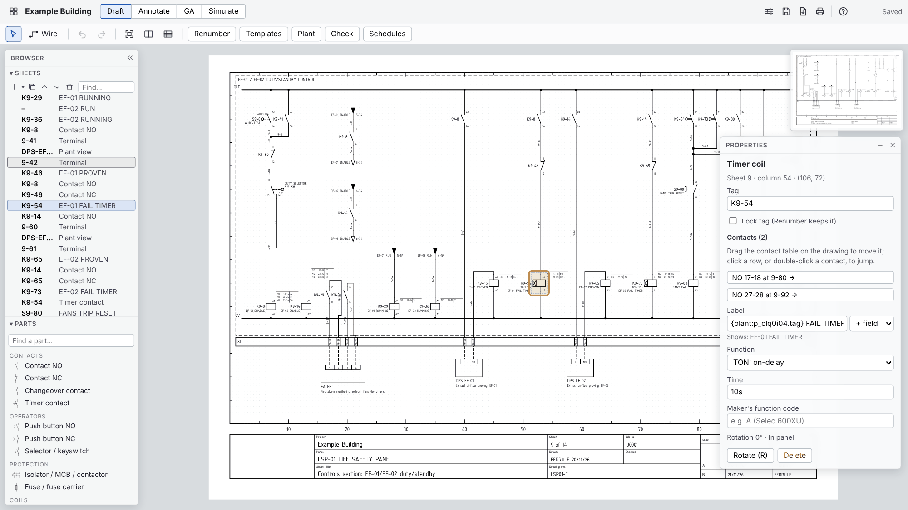
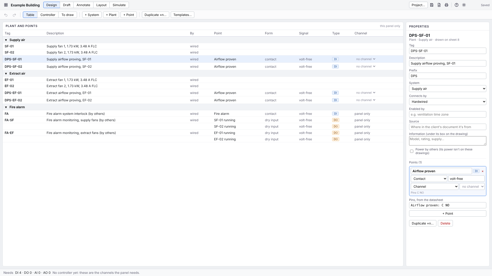
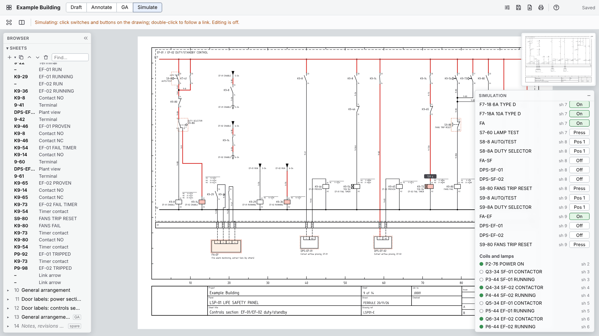
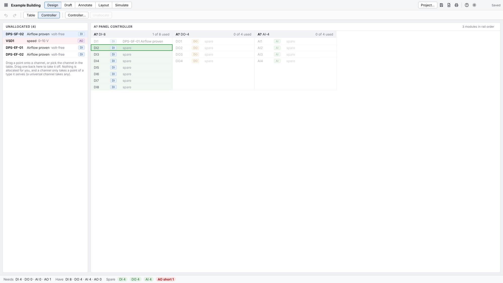
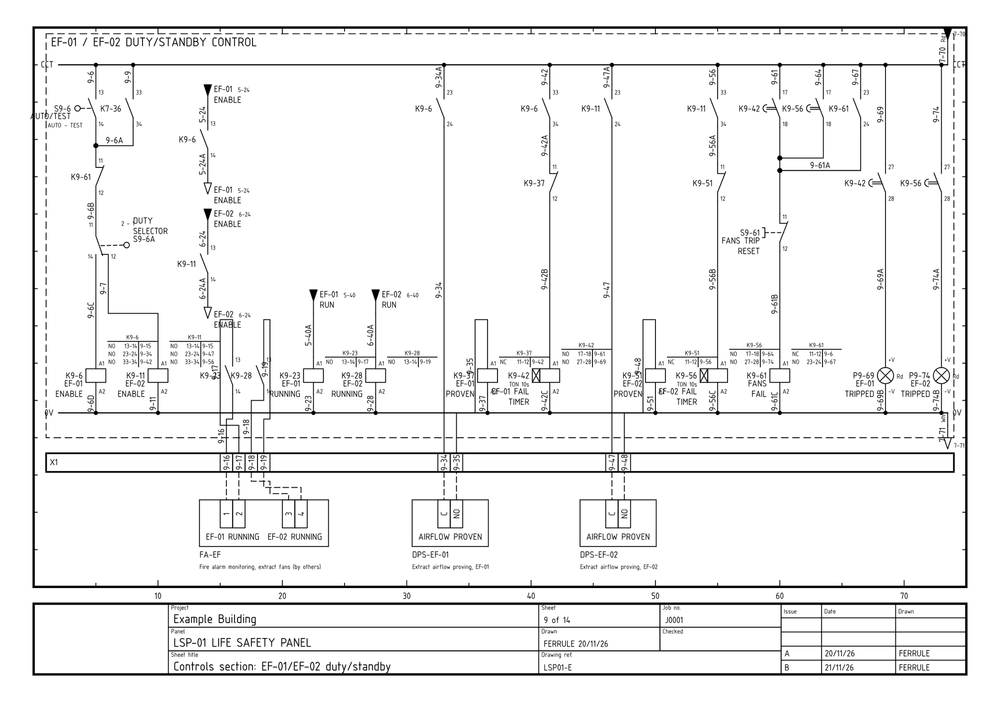

#  Ferrule

**Control panel schematics, drafted fast.** Ferrule is a lightweight drawing tool for electrical control panels: drop in parts, wire them up, and it numbers everything, cross-references every contact to its coil, draws the title block and exports an A4 PDF set. Then it lets you *run* the drawing to check the logic, lay the panel out at true scale, and hand the lot to Claude to draft for you.

It's one portable `.exe` for Windows: no install, nothing to configure. Your browser is the screen.



**[Download the latest release](https://github.com/Cryptdos/ferrule/releases/latest)**: unzip `ferrule.exe` anywhere (e.g. `C:\Temp\eCAD`) and double-click it. Status: **0.1.0 preview**, for feature testing.

Ferrule is provided free, as is, with no support. Issues and pull requests are welcome, with no promise of a response.

## What it does

### Design: what the panel has, before it's drawn



Read the client's description of operations and list what this panel has: **systems** (*Chilled water*, *Ventilation*) group **plant**, and each plant item has its **points**, each with its form (from the plant's side: a fault is a contact, an enable an input), its signal (volt-free, 24 V, 0–10 V…) and where it goes: straight to a controller channel, to a channel through a relay, or only into the panel's own circuits. Every field device is plant on its own row, a pump's flow switch too. Ferrule works out the channel type each point needs (DI, DO, AI, AO), and the **Needs line** along the bottom counts them, so before there's a controller it already tells you how many inputs and outputs to buy. Nothing is drawn in Design, and there are no built-in plant types: rows and points are the only parts.

### Network: comms plant by network


Comms plant names its network: a LAN off a switch, or a bus off the controller, each with its protocol. The **Network view** draws them from the table, devices in order along each run, long runs shortened with a count. **Place as sheet** puts it on a sheet of its own in the set, redrawn from the data as networks change, so it prints with the rest. For a panel that is mostly a controller, a switch and forty networked devices, this is most of the job.

### Draft: the electrical drawing, and nothing else

Pick parts from the browser and click to place them; wires route themselves at right angles around everything. Contacts link to their coils, and the coil gets a contact table showing where each one is. Tags and wire numbers follow the sheet-column scheme (`K9-54`, wire `9-41`), with **Renumber** showing you exactly what will change before it changes anything. Plant (fans, dampers, interfaces by others) is defined once with all its terminals and shown on as many sheets as needed. **Check** finds loose contacts, coils without contacts, unpaired links and wires that leave the panel without a terminal.

### The panel boundary is a terminal block


Everything above the block is in the panel; everything below is out on site, with field cables drawn dashed. Terminals on the boundary become cells of the block with their number up the cell. The strip (`X1`) is named at the left end and wherever it changes, so an engineer reading the drawing sees `9-41` and the person building the panel can still find `X1:9-41`. Terminals can be **fused**, **disconnect** (knife) or **switched fuse**, drawn so you can't miss them.

### Simulate: try the logic before anyone wires it



Click switches, selectors, push buttons and plant outputs on the drawing. Coils pull in, contacts move, lamps glow in their colour, live wires go red and timers count down (TON, TOF, TP and flashers, named as IEC 61131-3). Power comes from the incoming supply, a transformer or plant that supplies power (a UPS, a PSU), phases kept separate. Say what each supply **gives** and each coil, lamp or plant input **takes** (24 V DC, 230 V AC, or either), and Check finds a load fed from the wrong supply, and a distribution with loads that nothing supplies. An interlock whose point can never come on is reported as *never on: is it powered?*, not proved. An interlock can have several conditions, all of them (*never on while the fire alarm is unhealthy and the override is off*) or any one; proving goes one interlock at a time, showing each result as it lands. **Expectations** say what the drawing should do, in plain words ("FA-SF SF-01 running should be on when K8-23 is energised", "Never: K8-6 and K8-11 energised"): plant inputs turn green or red as you go, and **Check logic** tries every sequence of operations to find one that breaks an expectation, shorts the supply or makes relays chatter, with a replay.

### Controllers: built in Design, drawn in Draft



The panel's controller is built in **Design**: its modules in rail order, and each point put on a channel by hand, by dragging it there or picking the channel in the table. Only channels of the right type take a point, and a channel's label follows the point on it (`DPS1 flow`), on the drawing and in the IO schedule. An outstation or PLC is its modules in rail order, each made from a generic type (DI-8, DO-8, UIO-16…) with its pins generated from the datasheet's pattern. Module views sit at the top of the sheet with their terminals underneath, so wires drop straight down to the plant and every connection is on the module's sheet. A module is tagged by where it's drawn (`A3-23`, sheet 3, column 23) and its points are `A3-23:DI2`, so a reference always tells you which sheet to turn to; a point drawn on a continuation says where, `A3-23:DO5 (4-10)`.

### Layout: the panel at true scale


General arrangement (GA) sheets laid out to scale in the **Layout** workbench: the **backplate**, the **door front** and the **door back** (seen from inside, mirrored, with the cut-outs). Draw DIN rails and trunking, then use **Place parts…** to put every relay, timer, breaker, terminal strip and controller (its modules side by side, in rail order) from the schematic on the backplate: each keeps its tag, snaps onto a rail, and **Check** tells you what's still to place and how full each rail is. On the door, lamps, push buttons, keyswitches and an isolator's handle are drawn from their schematic parts, so the door can't drift from the drawing; doors have one or two leaves, or are **modular**: columns of stacked doors, each with its own hinge and name, a device belonging to the door it's on and dimensioned from that door's edges; a sheet can show any one leaf or door on its own, and each door can have its own **backplate** sheet behind it (a compartment's mounting plate, sized from its door). Add **label plates** at true size and **dimensions** (chain or baseline) that snap to what they measure and follow it when it moves. Sizes start generic; pick real devices from the **device table**, a shared library with sizes, datasheets and pictures that every project can use, and export the **bill of materials** as CSV.

### Annotate: everything the reader needs


Text, boxes, arrows, highlights, numbered call-outs, polygons, pictures (paste or drag them in), section boxes and revision clouds live in their own workbench, so they never get in the way of the drawing. **Text** is Markdown (headings, bold, italic, strikethrough, lists, task lists, quotes, code, tables) for general notes and cable sizes. The **revision list**, **symbol legend** and **controller map** fill themselves from the project. **Spare sheets** hold annotations only, for spacing and organisation.

### The output



Every sheet exports as one A4 landscape PDF, in [osifont](https://github.com/hikikomori82/osifont) (ISO 3098 lettering) throughout, with your title block, logo and revision table. Terminal and field cable schedules, the bill of materials and Design's points schedule export as CSV.

### Claude can draft for you

Ferrule is also an [MCP server](docs/mcp.md): connect Claude to it and ask for a starter sheet, a set of plant, or a whole controls section, and watch it appear in the editor. The [LSP-01 example](docs/benchmark-lsp01.md) (on the project list) is a 16-sheet life safety panel drawn entirely with Ferrule's own tools.

## More

- [Building Ferrule](docs/BUILDING.md): build the exe yourself, from a fresh clone
- [Design document](docs/DESIGN.md): how it works and every decision taken
- [v0.2 design](docs/design-v0.2.md): what's changing after testing v0.1.0-pre
- [v0.2.1 design](docs/design-v0.2.1.md): fixes from testing the v0.2 builds (ended at its step 2)
- [v0.3 design](docs/design-v0.3.md): busbars, terminals and numbering, tiling windows, alignment tools, GA detail sheets (built, being tested)
- [v0.4 design](docs/design-v0.4.md): the plan now being built (the Design workbench: plant, points and the controller; GA renamed Layout; network drawings)
- [Benchmark: LSP-01 life safety panel](docs/benchmark-lsp01.md)
- [MCP server: letting Claude draft drawings](docs/mcp.md)

## Running it

### Portable Windows .exe

`ferrule.exe` is the whole thing in one file. Put it in a folder (e.g. `C:\Temp\eCAD`), double-click it, and your browser opens on Ferrule. A console window shows the address; close it to stop Ferrule. New projects are saved in a `projects` folder next to the .exe; *Open file…* and *Save as…* work with a project file anywhere.

PDF export uses Microsoft Edge in the background (or Chrome, if Edge isn't there). Nothing needs installing. Windows may warn the first time because the .exe isn't signed: *More info → Run anyway*.

To build it yourself: install [Bun](https://bun.sh), then `bun install` and `bun run build:exe` (→ `dist/ferrule.exe`). [docs/BUILDING.md](docs/BUILDING.md) goes through it step by step, on Windows, Mac or Linux. CI also builds it on every pull request; it's attached to the run as the `ferrule-windows` artifact.

### From source

Needs [Bun](https://bun.sh) (developed with 1.4). Full steps, including Windows, in [docs/BUILDING.md](docs/BUILDING.md).

```sh
bun install
bun run build      # build the browser UI into dist/web
bun run start      # start the server and open http://127.0.0.1:4810/
```

A project is one `.ferrule` file (JSON) with everything in it, pictures included, so it can be copied, emailed or kept in a job folder. New projects go in a `projects` folder (next to the program when running as the .exe, otherwise in the current folder); files opened from elsewhere stay where they are and are remembered in the project list. The previous save is kept as `.bak`. Ferrule 0.2 can't open projects made with 0.1 (there's no upgrading before 1.0); they need redrawing. *Delete* on the project list moves the file to `projects/Deleted`.

Set `FERRULE_BROWSER` to the path of a Chromium-based browser to choose which one makes PDFs.

**Claude:** Ferrule is also an MCP server, at `http://127.0.0.1:4810/mcp`, or `ferrule.exe --mcp` over stdio. See [docs/mcp.md](docs/mcp.md).

Server options: `--port 4810`, `--host 0.0.0.0` (to reach it from another machine), `--projects <folder>`, `--no-open`.

### Development

```sh
bun run dev        # server on :4810 with reload, plus Vite on :5173 (use this one)
bun run typecheck
bun test
```

## Layout

| Path | What |
|---|---|
| `src/core` | Shared model: geometry, symbols, operations, numbering, loading. Used by the UI, the server and (later) the MCP tools. |
| `src/server` | Bun + Hono server: project storage and the API, serves the UI. |
| `src/web` | Svelte UI, drawing in SVG. |
| `src/bench` | Example projects built through the core operations: LSP-01 (the example on the project list) and BMS-01, a generic BMS panel used as a before-and-after fixture (`bun scripts/build-bms01.ts out.ferrule`). |

Drawings use [osifont](https://github.com/hikikomori82/osifont) (ISO 3098 lettering, LGPL-3 with font exception), bundled in `src/web/fonts`. It is the only font on drawings and is embedded in the PDFs.

Wire routing uses [libavoid-js](https://github.com/Aksem/libavoid-js) (LGPL-2.1-or-later), loaded as a separate WebAssembly file.

## Using the editor

To see what a finished set looks like, choose *add the LSP-01 example* on the project picker.

**The window:** the top bar has two rows. The first has the project list, the workbenches, *Project…* (title block, logo, revisions), and icons for *Save as*, *Export PDF*, *Print*, help and **Settings** (hover any icon for its name). The second is in the same order on every workbench: undo and redo, the view (Fit, Split), its tools (Select first, then Wire in Draft), then its menus (Renumber, Templates, Plant, Distribution, Table, Check, Expectations…, Schedules; Device table… in Layout; in Design, its views and their buttons). A menu's button opens its window and, clicked again, closes it. The drawing fills the rest of the window, with three see-through panels floating over it:

- **Browser** (left): the sheets, and the parts for the workbench in use. Fold it away with `«`.
- **Properties** (right): shows when you click something. Drag it by its title bar and it stays where you put it; `–` folds it to its title.
- **Overview** (top right): the whole sheet with the part you're looking at outlined, and which sheet it is (`3 / 14`). Drag the outline, or click anywhere on it, to move about.

Everything else (Plant, Check, Schedules, Settings…) opens in a **window**: drag it by its title bar, `–` minimises it to its title, `×` or `Esc` closes it (`Esc` on the drawing closes the window on top, once there's nothing being drawn or placed to cancel). Windows don't block the drawing, so you can keep looking, scrolling and working behind them, several can be open at once, and each remembers where you put it. On screen the sheet is a warm off-white, easier on the eyes; print and PDF are white. Settings has an optional dark interface, in dark greys rather than black.

**Workbenches**: each shows only its own tools, so the palette stays short.

- **Design**: the panel's systems, plant and points as a table (below). Nothing is drawn here; Draft draws what's listed.
- **Draft**: the electro-mechanical drawing: parts, wires, busbars, plant, numbering, links. Everything a part needs to say (tag, rating, function, colour) is a property of the part, not loose text.
- **Annotate**: text, boxes, pictures (or the logo), section boxes and revision clouds (all in its parts list), to explain the drawing to the reader. In Annotate only annotations can be selected, and in Draft only drawing parts, so a box round a group of parts never gets in the way; what you can't pick is drawn grey on screen.
- **Layout**: general arrangement (GA) sheets drawn to scale (below). It was called GA until v0.4.
- **Simulate**: the same sheets, live (below).

- **Plant is made in Design:** Draft's *Plant* window lists it to give pins and place views (*Place view*, *Pins and points…*); its tag, description, prefix, information and *power by others* are edited in Design's Properties, along with its pins. Editing a placed view from Draft (terminals shown, labels) works as before: it's the same data. A project with no plant and no controller works in Draft alone, as it always has.
- **Design's table:** *+ System* adds a system (pick its row to rename, move or delete it; its plant stays, with no system). *+ Plant* adds an empty row in the picked system, after the picked plant. *+ Point* gives the picked plant a point: its name, form and signal; it has no pins until the plant is specified or drawn (marked ○). Pick a row to edit it in Properties: tag (empty: Renumber tags it from where it's drawn), description, prefix, system, how it connects (hardwired, comms or both; comms adds the protocol and network), what enables it and where in the client's document it came from, the information under its box and *power by others*, its pins (one line, `enable: 1 2 | fault: 11 14`), and each point's name, form, signal, where it goes and its channel. Systems fold (▸), showing a count. `Ctrl`/`Shift`+click picks several plant rows, to move them to a system or delete them. Plant from older projects sits under *No system*.
- **Duplicate ×n and templates** (Design): pick one plant row or several (`Ctrl`+click) and *Duplicate ×n…* copies them n times after the last of them, each copy's tags stepping on by the step you give (P1 → P2, P3; `AHU-01` → `AHU-02`); the window shows the tags first, and one that's already taken is left empty. Copies keep their points and signals, and links between rows of the group follow the copies; they aren't on any channel, and aren't drawn. *Templates…* keeps your own Design templates, a list apart from Draft's templates: *Save selection as template…* saves the picked rows, and a template is inserted into a system as many times as you like, with what it needs from the controller (DI, DO, AI, AO) totalled before you insert. None are built in. They're kept in `library/design` beside the projects folder, so every project can use them, and nothing links back: inserted rows are ordinary plant.
- **To draw** (Design): what Design has that isn't on a sheet yet, field plant and modules, each with a red dot until it's drawn; what's drawn is ticked, with its sheets. *Place on sheet* opens Draft with it ready to drop on the open sheet (or the nearest schematic sheet), its tag, pins and channel labels from the data; drawn plant and modules can have another view placed the same way, to split them across sheets. A point with no pins gets them first: Ferrule suggests numbered pins (`enable: 1 2 | fault: 3 4`) for you to change to the datasheet's, then places it.
- **Check** (Design and Draft) adds Design's findings once a project uses Design: a point that goes to a channel and has none, plant in the table not drawn yet, and equipment drawn below the panel boundary that isn't plant in the table (local isolators are left out: they're drawn as switches). Every allocated point's **wiring to its channel** is checked, never guessed: *direct* when the point's wire reaches the channel's own pin (supply rails and an input's shared common don't count); *via one relay* (✓ via K8-37) when the point's wire reaches a relay's coil and a contact of that same relay reaches the channel's own pin, or the other way round for an output; anything else (two relays, a switch or timer between, contacts combined) is **to review**, and once you've checked the drawing, *Confirm by hand* (in Check, or the point in Properties) marks it wired. A confirmation is kept against the wiring at both ends as it was: change either and it's back to review by itself; changes elsewhere leave it alone. *Show* on a Design finding opens it in the table.
- **Interlocks** (Design, a plant item's Properties): *this point is never on while that condition holds*: "P1 enable never on while PU1 fault", the point one of the plant's own, the condition any on/off point in the table. Each makes a *never* expectation (shown in Expectations…, marked as made by an interlock, and changed only here), so **Simulate proves it** as it proves any expectation. *Check logic* in Simulate, or *Prove* in Design (and *Prove all* in To draw), tries every sequence that can affect it: proved, fails, or not proved yet; one whose points aren't drawn isn't proved. Proofs are for the drawing as it was: change it, and they're asked for again. Check and To draw list what isn't proved.
- **Network** (Design): *+ Network* adds one (*LAN 1*, *Bus 1*…): name, protocol (BACnet IP, Modbus RTU…, free text) and kind (a LAN off a switch, or a bus off the controller). Put comms plant on it in the plant's Properties (*Connects by* comms or both, then *Network*) or from the network's list (*Put a device on it…*). Devices are in row order, which is the order along a bus: ↑ ↓ moves a device, and its row in the table with it. Deleting a network leaves its devices on none. *Place as sheet* adds a spare sheet titled *Network diagram* at the end of the set with a **Network diagram** on it (also in Annotate's *Tables*), redrawn from Design's networks whenever they change; set its width in its properties. The drawing is the controller and a switch along the top, each LAN a trunk off the switch with its devices, each bus a chain from the controller; after sixteen devices on a LAN, or eight on a bus, the rest are counted (*… FCU-17 to FCU-19 (3 more)*). Addresses aren't held in v0.4.
- **Export points schedule** (Design's top bar): every point in the table as a CSV, by system and in row order: system, tag, description, point, form, signal, type (DI, DO, AI, AO), goes to, controller, module, channel, *via* (the relay, when the check traced one), and *wired* (direct, via, confirmed, to review, not drawn). Unallocated points are listed with the channel empty; plant with no points is a row of its own. Importing one isn't in v0.4.
- **Controller** (Design): the panel's controller, its modules in rail order, each channel with the point on it or *spare*, and the points still to allocate on the left. A panel has one controller (anything outside it is plant): *Add the controller*, then *Controller…* to describe it and add modules, spares and addresses. **Allocation is by hand:** drag a point onto a channel (only channels that can take it light up; a universal channel takes any type), or pick its channel in the table's *Channel* column or in Properties, which offer only free channels of the right type. Drag a point back to *Unallocated*, or pick it and *Unallocate*, to take it off. A point that no channel can take says why in red (*the panel has no analogue outputs*). A point *via relay* is allocated the moment it has a channel; a *panel only* point never needs one. **Suggest…** proposes channels for the points still to allocate (in table order, a module of the point's own type before a universal one): untick a line or pick another channel, then *Accept ticked*, or *Throw away*. It never runs by itself, and nothing is allocated until you accept.
- Pick a part on the left (type in *Find a part…* to narrow the list) and click on the sheet to place it; then it's back to selecting. To place the same part again and again until `Esc`, tick *Keep placing* in Settings.
- Drag to move (snaps to the grid), drag on empty paper to box-select, `Shift`/`Ctrl`+click to add to the selection.
- `R` rotate, `F` flip top to bottom (a contact drawn upside down still reads right), `Del` delete, `Ctrl+D` duplicate, arrow keys nudge, `Ctrl+Z`/`Ctrl+Y` undo/redo; tap `Space` to fit the sheet (hold it and drag to pan).
- Scroll to zoom, middle-drag or `Space`+drag to pan.
- `W` wire tool: click a terminal, then another. Click part-way along a wire to tee into it (a junction dot is added). Wires to a busbar drop straight onto it. `S` or `Esc` goes back to selecting.
- Wires route themselves at right angles around symbols. Select a wire and drag one of its legs to adjust it by hand; *Reset route* hands it back to the router.
- Saving is automatic.
- **Sheets** (in the browser): `+` adds a sheet after the current one (`▾` for a *spare sheet*), then duplicate, move up, move down and delete. `PgUp`/`PgDn` switch sheets. `▸` folds a sheet open to list what's on it for the workbench in use, in column order: click one to select it and bring it into view. *Find…* searches every sheet. The `⚙` on a sheet (or double-click its name) opens its settings: title, panel boundary, spare.
- **Spare sheets** hold annotations only (notes, tables, pictures): use them for spacing and organisation, or for a notes sheet. Draft is greyed out on them. Set *Sheet type* in a sheet's settings to *Spare* to make an empty sheet spare, or to *GA* to make it a general arrangement.
- **Numbering:** tags show as `K?`, `S?`… until you press **Renumber**. Position scheme (default): tags, terminals and wire numbers are the sheet-column where they are, e.g. `K3-16`, wire `3-22`; the highest in a column keeps the plain number and the rest get A, B, C. **A wire on a terminal takes the terminal's number**, so the two always agree (if it reaches several, the first along the strip, by sheet then left to right); any other wire is numbered from its highest end. **Check** warns about a locked wire number that disagrees with its terminal. Numbering stops at busbars: each wire leaving one gets its own number. Sequential (K1, K2…, wire 100, 101…) can be chosen under Project…. Tick *Tag fixed* on a part, or lock a wire number, to keep it.
- **Numbering:** **Renumber** first shows a table of what would change (old → new for tags, plant, terminals and wire numbers); nothing changes until you *Apply*.
- **Links:** select a contact and pick its coil under *Driven by coil* (listed by tag and description): it takes the coil's tag and pole number (13/14, 23/24, 31/32…), and the coil gets a contact table to its right showing where each contact is (drag the table to move it; click a row to jump to that contact). **Double-click** a contact to jump to its coil, a coil to its first contact, or a link arrow to its partner (in Simulate too); where you land is highlighted until you select something else. References are always in full (`11-06`), on the same sheet too; a contact table has its coil's tag above it.
- **Link arrows** pair up under *Continues at*, or with *Link…* (below). Tick *Source* on the one the wire comes from; its partner becomes the destination (filled). The wire keeps its number across sheets. An arrow shows the **wire number** it carries, always horizontal and in line with it (left of a vertical arrow; beyond the free end of a horizontal one), and its **partner's reference in brackets**, `(4-24)`, after the label at its tip. Brackets always mean a place, a bare number always a wire, so the two can't be confused. An arrow dropped straight onto a part's pin is on that pin's wire and shows its number.
- **Distribution blocks, control rails and distributions:** a **Distribution block** is the physical busbar or block (drawn heavy, tagged W, placed on the GA and counted in the bill of materials); a **Control rail** is the common rail of a control drawing (CCT, 0V: drawn in the control weight, no tag, not a GA part). Under **Distribution** in the top bar, list the supplies the project distributes (L1, N, CCT, 0V…, with kind, voltage, colour (picked from the core colours, as on a wire) and function (free text, with suggestions); new projects start with none). A block, a rail, a link arrow or an incoming supply terminal picks one from the list, and everything on the same distribution is joined on every sheet, so CCT can simply be drawn again on the next sheet. A block or rail on no distribution is *local* and joins nothing else. Its name sits at its left end, beside its tag, and can be printed at both ends.
- **Wires:** a wire's colour, function and number print at the end it was drawn from; the number once per sheet, on the longest run, and not on earth or field wires unless you tick *Show number*. A new wire takes its colour from the busbar it leaves, or from the wire on the other side of the fuse, contact or terminal it's drawn from; change it any time. Wires from a cable screen are dashed. A **cable screen** has no tag; its drain wire attaches at either end.
- **Labels** are one line; a part's *Label width* (always in its properties) wraps a longer one onto more lines. Lamps always have a colour (white for a clear lens). **Call-outs** are numbered 1, 2, 3… on their sheet in the order they were placed while *Auto* is ticked (the default); untick it to set a number by hand. While placing a part, `R` turns and `F` flips it. Plant views are all at least as tall as a 5-character pin name, so they line up. A terminal strip line is drawn over the terminals it crosses. **Colour check** (next to Split in Draft) draws every wire and busbar in its core colour, with a dark edge so white shows, and grey dashes where no colour is set: a quick way to see the colours are right. Print and PDF stay black.
- **Terminals:** *Earth* terminals show the earth sign (green-yellow on the GA). A *Terminal strip line* drawn through a group of terminals puts them all on its strip.
- **Link arrows:** select one and click *Link…*, then click its partner on any sheet (or *Link to a new arrow* to drop one). A destination shows its source's label unless you untick *Same label as its source*.
- **Wires:** select a wire to set its number, core colour (IEC codes written Bu, Bn, GnYe…) and function (0V, 24V…). They print together at the end the wire was drawn from (*Other end* flips it); on a wire too short for them they're centred on it. Wires go straight onto a terminal and keep their number through it.
- **Field wires:** *Kind: Field* draws a wire dashed. Wires below the panel boundary are field wires automatically. Field wires don't print their number unless you tick *Show number*; any wire's *Show number* and *Show colour* can be unticked to cut clutter where nothing is lost.
- **Lamps** have +V and -V terminals and an optional lamp-test terminal LT; colours are codes (Rd, Gn, Ye, Bu, Wh, Cl). **Timer coils** take an IEC 61131-3 function (TON on-delay, TOF off-delay, TP pulse, flashers), a time (`500ms`, `5s`, `1.5s`, `2min`) and the maker's code for it; the simulator runs each one.
- **Contacts** linked to a timer coil are timed by it: they switch with the timer's function, print 17-18 (NO), 15-16 (NC) or 15-16/18, and carry the delay mark. Tick *Instantaneous* for a timer relay's plain contacts. **Push button**: 1 to 4 poles on one head, each NO (k3/k4) or NC (k1/k2). **Selector / keyswitch**: 2 positions (0–I) or 3 (I–0–II), 1 to 4 poles, each pole NO or NC and closed in the positions you pick, or a changeover (on a 3-position switch numbered as makers do: common 2, closed to 3 in I, open in 0, to 1 in II; the next pole 7, 6, 5). Each position has a name (*SUPPLY 1*, *OFF*, *SUPPLY 2*), drawn under the head as `SUPPLY 1 – OFF – SUPPLY 2`; in Simulate a click steps it to its next position and the one it's in is boxed. **Isolators** take a rotary handle, door handle, key, or none (worked by something else).
- **Earth** takes a type (earth, protective, functional, chassis, equipotential: IEC 60417 symbols). The **socket** has L and N on top, 3 apart to line up under an MCB, and E out to the side.
- **Incoming supply** (Connection group) is where the simulator's power comes from: pick 3-phase + N, 3-phase, single phase or DC.
- Fields such as *Ratings* show an example as placeholder text, so every plant is written the same way.
- **Plant…:** the plant made in Design, to give it pins and *Place view* on any sheet (field equipment is defined once, in Design: prefix, description, information lines such as model and rating). The tag works like every other tag: prefix plus sheet-column where it's first shown, e.g. `SEF-3-13` for a safety extract fan, `U3-13` with the default prefix; type a tag (in Design) to fix it instead. Its terminals (pins) are split into **points**, one signal each, written as `Mains: L N E | R1: C NO NC | R2: C NO NC`: pins sit in boxes along the top with each point's name in capitals under them (the same pin names can be used in different points). *Pins and points…* opens the full table: each pin's number (what's wired), id (C, Y1, VO) and group (IO1, AO1), drawn when present; and each point's **form** (contact, powered output, dry or powered input, analogue in or out, supply in, supply out, comms) and how it simulates. Tick the terminals a sheet shows; hidden ones give the box a break line. *Power by others* adds a break on the left. The tag and details print under the box. Labels can include `{plant:…}` fields (the *+ field* picker) so they always match the plant's tag.
- **Controller…** (Design → Controller): the panel's controller (one per panel), its **modules in rail order** (power supply, host, DI, DO, UIO, AI, AO, with a channel count: a DI-8, a UIO-16) and any **spare slots**, with each slot's bus address (from rail order, or set to match its DIP switches). *Generate…* fills a module's pins from a pattern: the channels, each channel's pin ids (`VO RET CO`, `IO C`, `Y ⊥`), the first pin number, the names (`AO#` → AO1, AO2…), the first channel's number for makers that number across the controller, and any pin shared by several channels (a common `⊥`); *Pins and points…* touches up the rest. A channel's **label** follows the point allocated to it (*DPS1 flow*), and changes when that point or its plant is renamed or retagged; a channel with no point keeps a label typed by hand (*Pins and points…*). *Save model* keeps a module entered from its datasheet in the device table, pins and all (and from there in the shared library with its datasheet and GA size), so the next one is *Add a saved model…*. A module is tagged by where its first view is, prefix **A**: a DI module drawn at sheet 3, column 23 is `A3-23`, and its points are `A3-23:DI2`. *Place on sheet* in Design's **To draw** goes to Draft and puts it at the **top of a schematic sheet, terminals along the bottom**: a title row (`A3-23 · DI-8 · part of A2-5, AHU-1 outstation`), the heading, each channel's name, pin ids and numbers, and each point's label along its wire. Split a module across views and sheets by ticking the channels each shows (a break marks the cut edge); it keeps one tag, the continuation says where it carries on from, and a point drawn there is referred to with where it is, `A3-23:DO5 (4-10)`, so a reference always lands on the point. Wire every connection at the module, outputs that switch panel circuits out through link arrows.
- **Panel boundary:** tick it in the sheet settings. It's drawn as a **terminal block** across the sheet, with a little white space at each end: terminals placed on it (or dropped within a unit of it) become cells of the block with their number written up the cell (2.5 mm, like pin and wire numbers). Each cell is a column wide, so every terminal has its own column and its own number; one dropped closer than that to another moves along to the next free place. An earth terminal prints no number, just the earth sign centred in its cell (schedules and the GA still name it by its position). Panel wiring entering at the top and field cables leaving at the bottom. The strip name (`X1`) is at the left end of the block and again wherever the strip changes along it, so the cells only need the number (`3-13`); the terminal schedule lists them as `X1:3-13`, and a strip placed on the GA lists its terminals by sheet, then left to right. Drag the block (between terminals) to move it; its terminals go with it. Everything below is field equipment, and wires to it are drawn as dashed field cables. A wire crossing it without a terminal is flagged by **Check**.
- **Section** (`B`, or *Section* in Annotate's parts): drag out a dashed section box. Drag its label to move it, any edge or corner to resize that side. Boxes and sections are picked by their edge, so parts inside them can still be clicked.
- **Check** lists problems (boundary crossings, loose contacts, coils without contacts, unpaired off-page arrows, duplicate tags, plant terminals shown nowhere or twice) with a *Show* button. **Schedules** gives terminal and field cable schedules, the **IO schedule** (every controller's points: controller, module, point, form, pins, label and what it's wired to, through link arrows too) and **plant points**, downloadable as CSV. Check also reports two modules at one bus address, modules not drawn or with no pins, and a controller with no modules.
- **Tiles:** the drawing area can be split into tiles. **Split** in the top bar puts the active tile's sheet in a new tile beside it; each tile has a small bar with its sheet, *split right*, *split down* and *close* (the last sheet tile stays). Drag a divider to share the space. Every tile is a full sheet view with its own sheet, zoom and pan, and the same sheet can be open in two (an overview and a close-up). Click a tile to work in it: it's outlined, and the browser, Properties, the sheet list, the overview, Fit and `PgUp`/`PgDn` follow it. In **Simulate** every tile is live (states, live wires, clicks), sharing one simulation, and a door GA shows its lamps lit in their colour when their schematic lamps are lit (unlit ones dim): put the door in one tile and click the schematic in another. The door is for seeing only; the panel is worked through the circuit. **Windows go in tiles too:** drag Plant, Templates, Schedules, Table, Controllers, Distribution, Expectations or Check by its title bar onto a tile; dropping on an edge splits the tile, in the middle replaces what's there. Drag its tile out by the tile's bar to float it again; its menu button or the tile's close shuts it. Small prompts always float. Tiles aren't saved: a project opens with one.
- **Align and distribute** (Draft, Annotate and Layout, the eight icons after the tools): align left, centre or right, top, middle or bottom. One part picked aligns to the sheet (the space inside the border, above the title block), so a title can be centred on a cover sheet; two or more align to the first one picked, which stays put; a box selection aligns to the outline around them all. *Distribute across* or *down* (three or more) keeps the outer two and makes the gaps between them equal. Edges are a part's body, not its tag or label (the highlight on a part you've jumped to shows the same edges). Parts move as if dragged, to the grid, their wires following; GA items move in whole millimetres. Each is one undo step.
- **Table** (a window) lists every element in the project: filter by type, plant or text, edit tags and labels in place, and tick rows to find-and-replace or fix tags in bulk (*Tag fixed*).
- **Number boxes**: with one selected, scroll to step it, `Shift`+scroll for ten steps.
- **Settings** (top right): *Keep placing until Esc*, the dark interface, **Buttons** (the workbench and menu buttons as *Labels*, *Labels and icons*, or *Icons* with the name on hover; kept for this browser, like the theme), and **Status**: the version, projects folder and address; whether Claude is connected over MCP and the last tool it used; the exact settings to paste into Claude Desktop or Claude Code; and *Quit Ferrule*, which stops the server cleanly.
- **Export PDF** uses Edge or Chrome in the background. If it can't, it says why and offers *Print → Save as PDF*, which makes the same sheets.
- **Templates…:** save the current sheet, or a selected section box and what's in it, as a template. *Stamp…* makes a copy for other plant (pick existing plant or type a new tag) with fresh tags; sheets go in as a new sheet, sections where you click. *To library* saves a copy in the `library` folder beside `projects` for use in other projects.
- **Revision cloud** (Annotate's parts): drag round a change to cloud it for the latest revision (add revisions under Project…); the triangle shows the revision letter. Drag the triangle to move it, an edge to resize it; select it to change its revision or delete it. Only the latest revision's clouds are drawn.
- **Text** (Annotate): written in Markdown, with buttons for the usual marks: `# Title` (5 mm), `## Heading` (3.5 mm), `### Small heading` (bold), `**bold**`, `*italic*`, `~~struck~~`, `` `code` ``, `- bullet`, `1. numbered`, `- [ ] task` / `- [x] done` (two spaces indent a list), `> quote`, fenced code blocks, `| tables |` (a `|---|` row under the first makes it the heading row) and `---` for a line across; links print as their text. Body text is Note (2.5 mm). Left, centred or right; long lines wrap to the width you set (0: no wrapping). Text can hold fields: `{project:title}`, `{project:drawingNo}`, `{sheets}`, `{rev}` and plant fields. Text left empty is removed when you click away. **Box** for cover sheets and the like; label plates are drawn on the door GA, at true size.
- **Revision list** and **Symbol legend** (Annotate, Tables): drop them on a sheet and they fill themselves. The revision list shows the project's revisions (edit them under project settings) with blank rows to spare. The legend draws one of each kind of part used in the project with its name (e.g. *Circuit breaker / MCB*, *Contactor coil*), in 1 to 4 columns.
- **Controller map** (Annotate, Tables): a controller's modules in rail order, one box each with its tag, its bus address in a circle, maker, model, type and every sheet-column it's drawn at; spare slots dashed. Pick the controller in its properties; it wraps onto more rows to fit its width and keeps up by itself. Usually on the controller's first sheet, so "where's that module?" is answered at a glance.
- **Terminals** can be plain, **fused** (an IEC fuse drawn on the panel side, right on top of the terminal) **disconnect** (an open knife link) or a **switched fuse** (the knife with the fuse on its blade), set under *Type*. Terminals away from the boundary are drawn as small circles and can show their strip identifier (`X1`) beside them: tick it for one, or select several and tick it for them all. On the GA, fused and disconnect terminals take their own (wider) sizes.
- **Pictures** (Annotate): place a *Picture* like any part and choose its file in its properties, or paste one (`Ctrl+V`) or drag a PNG or JPEG in from Explorer. Drag the corner to size it. The company logo is set under *Project…* and prints in every title block; a *Picture* switched to *the project's logo* in its properties puts it anywhere else (a cover sheet). Pictures are stored in the project file, scaled down to 2400 px at most.
- **Layout**: *New GA sheet* sets the enclosure size and view (backplate or door); the scale is any number you type (1:7.5, 1:12…); *Fit* gives the largest that fits A4, and the usual scales are offered as you type. Draw DIN rails and trunking, then pick panel parts from *To place* (every relay, timer, breaker, terminal strip… from the schematic, not yet on a GA) and click to place them; they snap onto rails and keep their schematic tags. Sizes are generic per kind of part (*Generic sizes…* in the sheet settings) until you pick a real device: select the part and choose it under *Device*. Labels sit in the middle of each device, across it or along it, whichever is bigger; on very small devices the text gets smaller, down to a size still readable on an A4 print. A placed terminal strip keeps up with the schematic: add a terminal to X1 and the strip on the GA grows, and **Check** says so until you next open that GA. Notes on a GA are ordinary Text annotations (Annotate).
- **Detail sheets** (Layout): at door scale a plaque's lamps and legends are too small to read, so draw a **Detail** (Layout tools) round the area on any GA sheet: a dashed box lettered A, B, C… across the project, with a title in its properties, labelled `A (13)` with the sheet it's shown on. Add a GA sheet whose view is **Detail** (no enclosure, no scale of its own) and use *Place detail…* to put each detail in a **frame**: what's inside the box, the real lamps, plates and devices, cut off at the frame's edge, at the frame's own scale (2:1, 1:1, 1:2 or 1:5; the largest that fits by default), with a caption `DETAIL A: SUPPLY FAN, 1:1 (12)` naming the sheet it's drawn on. Moving or sizing the box changes the frame; frames move and align like any GA item. **You can work through a frame:** pick, move, size and set the properties of what it shows, and add DIN rail, trunking or label plates in it with the Layout tools; the change is made on the sheet the detail is drawn on and shows in both (Properties says which sheet). A **dimension** drawn in a frame measures what the frame shows and belongs to the frame, so it shows only there, not on the door at door scale. A detail is shown in one frame, and Check warns about one shown nowhere. In Simulate, door lamps light in frames too.
- **Device table** (Layout): real devices with their sizes from the datasheet (W × H × D), maker and part number, and the schematic part each suits (relay coil, contactor, MCB, earth terminal, lamp, push button…). Devices in the **shared library** (`library/devices` beside the projects folder) can be used by any project and keep their datasheets (PDF) and pictures: add them with *Add files…* or drop them on the device. A project keeps a copy of each device it uses, so it opens anywhere; if the library entry changes, *Update* takes the new size. Parts sized by hand keep their size. When creating a project you can leave the shared library out (and change that later under project settings) to start a project's device table from scratch. Drag to move, `R` rotate, arrows nudge 5 mm, `Del` removes from the GA. **Check** lists parts not on a GA yet.
- **Simulate**: click switches, selectors, isolators and field plant to operate them, and a fuse to blow it (click again to replace it; it's drawn broken); push buttons are held while the mouse is down (`Shift`+click latches). Coils pull in, contacts move, lamps glow in their colour, energised parts and live wires and busbars turn red, and timing timers show their countdown. `PgUp`/`PgDn` and double-click links work as in Draft. The floating simulation panel lists every device's points with their live state (inputs that don't see what's expected first), then every input, coil and lamp. Power comes from *Incoming supply* parts (each terminal can feed a distribution) and transformers (phases kept separate; a short between them, or two supplies feeding one conductor, is reported); without one, busbars on a line or DC + distribution are the supply and those on a neutral or DC 0 V distribution the return. Plant is simulated by its points: an **output** (a contact, a powered output, a supply out) is clicked, or *follows* up to two conditions joined with and/or after a delay ("Airflow proven follows SF-01 Run on, after 5 s"; a DC UPS output "follows Mains on or Battery on"); an **input** senses its pins (a dry input when its loop is closed, a powered input or supply in when there's a voltage across it). A supply out feeds the distributions it's set to, so an inverter, PSU or UPS powers its busbars with no stand-in supply drawn. Its terminal boxes are coloured by state: filled when on, green or red when the point has an expectation. **Expectations…** (beside Check, and in Simulate) keeps the list: *should be on (or off) when …* for inputs (a plant input or a controller's, `A3-23:DI2`), and *never …* for anything, e.g. two contactors of an ATS; a "never" that comes true raises a warning with its parts ringed red. **Check logic** searches every sequence of operations, plant outputs and timers for each expectation and reports the shortest way to break it, shorts or chatter, with *Replay*. **Check** reports a dry input wired to a live conductor, inputs wired to nothing, spare outputs, analogue points wired to digital ones and expectations naming something that's gone.
- **Project settings** (the sliders icon) sets the title block fields (project, panel, job no., drawing ref., drawn/checked), the logo and the revision table. **Save as…** writes the project to a new file anywhere and carries on in it.
- **Export PDF** downloads every sheet as one A4 landscape PDF. **Print** opens the same sheets in a browser tab and prints them, if PDF export isn't available.
