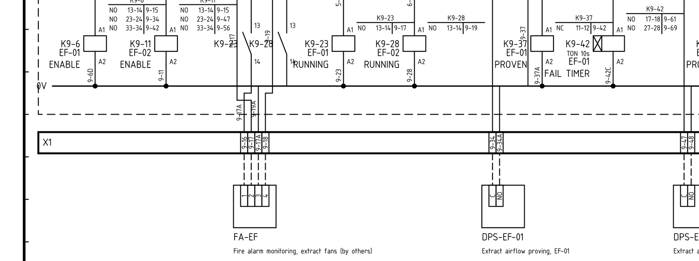
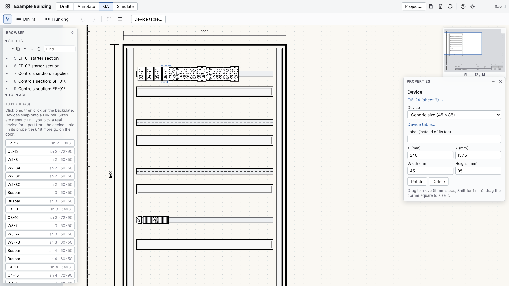
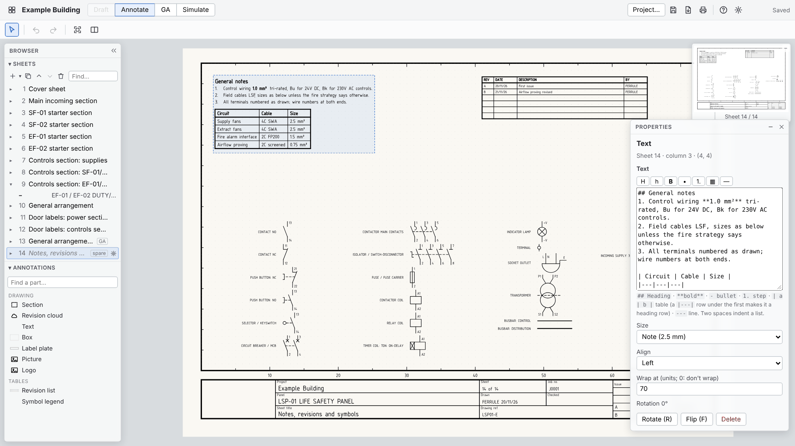

# Ferrule

**Control panel schematics, drafted fast.** Ferrule is a lightweight drawing tool for electrical control panels: drop in parts, wire them up, and it numbers everything, cross-references every contact to its coil, draws the title block and exports an A4 PDF set. Then it lets you *run* the drawing to check the logic, lay the panel out at true scale, and hand the lot to Claude to draft for you.

It's one portable `.exe` for Windows: no install, nothing to configure. Your browser is the screen.


**[Download the latest release](https://github.com/Cryptdos/ferrule/releases/latest)**: unzip `ferrule.exe` anywhere (e.g. `C:\Temp\eCAD`) and double-click it. Status: **0.1.0 preview**, for feature testing.

## What it does

### Draft: the electrical drawing, and nothing else

Pick parts from the browser and click to place them; wires route themselves at right angles around everything. Contacts link to their coils, and the coil gets a contact table showing where each one is. Tags and wire numbers follow the sheet-column scheme (`K9-54`, wire `9-41`), with **Renumber** showing you exactly what will change before it changes anything. Plant (fans, dampers, interfaces by others) is defined once with all its terminals and shown on as many sheets as needed. **Check** finds loose contacts, coils without contacts, unpaired links and wires that leave the panel without a terminal.

### The panel boundary is a terminal block



Everything above the block is in the panel; everything below is out on site, with field cables drawn dashed. Terminals on the boundary become cells of the block with their number up the cell. The strip (`X1`) is named at the left end and wherever it changes, so an engineer reading the drawing sees `9-41` and the person building the panel can still find `X1:9-41`. Terminals can be **fused**, **disconnect** (knife) or **switched fuse**, drawn so you can't miss them.

### Simulate: try the logic before anyone wires it


Click switches, selectors, push buttons and field contacts on the drawing. Coils pull in, contacts move, lamps glow in their colour, live wires go red and timers count down (TON, TOF, TP and flashers, named as IEC 61131-3). Power comes from the incoming supply or a transformer, phases kept separate. **Check logic** tries every sequence of operations and reports the shortest one that breaks a rule you set (e.g. two contactors never both on), shorts the supply or makes relays chatter, with a replay.

### GA: the panel at true scale



General arrangement sheets laid out to scale. Draw DIN rails and trunking, then place every relay, timer, breaker and terminal strip from the schematic: each keeps its tag, snaps onto a rail, and **Check** tells you what's still to place. Sizes start generic; pick real devices from the **device table**, a shared library with sizes, datasheets and pictures that every project can use.

### Annotate: everything the reader needs



Text, boxes, label plates, pictures (paste or drag them in), section boxes and revision clouds live in their own workbench, so they never get in the way of the drawing. **Notes** take a small Markdown (headings, bold, lists, tables) for general notes and cable sizes. The **revision list** and **symbol legend** fill themselves from the project. **Spare sheets** hold annotations only, for spacing and organisation.

### The output


Every sheet exports as one A4 landscape PDF, in [osifont](https://github.com/hikikomori82/osifont) (ISO 3098 lettering) throughout, with your title block, logo and revision table. Terminal and field cable schedules export as CSV.

### Claude can draft for you

Ferrule is also an [MCP server](docs/mcp.md): connect Claude to it and ask for a starter sheet, a set of plant, or a whole controls section, and watch it appear in the editor. The [LSP-01 example](docs/benchmark-lsp01.md) (on the project list) is a 14-sheet life safety panel drawn entirely with Ferrule's own tools.

## More

- [Building Ferrule](docs/BUILDING.md): build the exe yourself, from a fresh clone
- [Design document](docs/DESIGN.md): how it works and every decision taken
- [v0.2 design](docs/design-v0.2.md): what's changing after testing v0.1.0-pre
- [Benchmark: LSP-01 life safety panel](docs/benchmark-lsp01.md)
- [MCP server: letting Claude draft drawings](docs/mcp.md)

## Running it

### Portable Windows .exe

`ferrule.exe` is the whole thing in one file. Put it in a folder (e.g. `C:\Temp\eCAD`), double-click it, and your browser opens on Ferrule. A console window shows the address; close it to stop Ferrule. New projects are saved in a `projects` folder next to the .exe; *Open file…* and *Save as…* work with a project file anywhere.

PDF export uses Microsoft Edge in the background (or Chrome, if Edge isn't there). Nothing needs installing. Windows may warn the first time because the .exe isn't signed: *More info → Run anyway*.

To build it yourself: install [Bun](https://bun.sh), then `bun install` and `bun run build:exe` (→ `dist/ferrule.exe`). [docs/BUILDING.md](docs/BUILDING.md) goes through it step by step, on Windows, Mac or Linux. CI also builds it on every pull request; it's attached to the run as the `ferrule-windows` artifact.

### From source

Needs [Bun](https://bun.sh) (developed with 1.4). Full steps, including Windows, in [docs/BUILDING.md](docs/BUILDING.md).

```sh
bun install
bun run build      # build the browser UI into dist/web
bun run start      # start the server and open http://127.0.0.1:4810/
```

A project is one `.ferrule` file (JSON) with everything in it, pictures included, so it can be copied, emailed or kept in a job folder. New projects go in a `projects` folder (next to the program when running as the .exe, otherwise in the current folder); files opened from elsewhere stay where they are and are remembered in the project list. The previous save is kept as `.bak`. Ferrule 0.2 can't open projects made with 0.1 (there's no upgrading before 1.0); they need redrawing. *Delete* on the project list moves the file to `projects/Deleted`.

Set `FERRULE_BROWSER` to the path of a Chromium-based browser to choose which one makes PDFs.

**Claude:** Ferrule is also an MCP server, at `http://127.0.0.1:4810/mcp`, or `ferrule.exe --mcp` over stdio. See [docs/mcp.md](docs/mcp.md).

Server options: `--port 4810`, `--host 0.0.0.0` (to reach it from another machine), `--projects <folder>`, `--no-open`.

### Development

```sh
bun run dev        # server on :4810 with reload, plus Vite on :5173 (use this one)
bun run typecheck
bun test
```

## Layout

| Path | What |
|---|---|
| `src/core` | Shared model: geometry, symbols, operations, numbering, loading. Used by the UI, the server and (later) the MCP tools. |
| `src/server` | Bun + Hono server: project storage and the API, serves the UI. |
| `src/web` | Svelte UI, drawing in SVG. |

Drawings use [osifont](https://github.com/hikikomori82/osifont) (ISO 3098 lettering, LGPL-3 with font exception), bundled in `src/web/fonts`. It is the only font on drawings and is embedded in the PDFs.

Wire routing uses [libavoid-js](https://github.com/Aksem/libavoid-js) (LGPL-2.1-or-later), loaded as a separate WebAssembly file.

## Using the editor

To see what a finished set looks like, choose *add the LSP-01 example* on the project picker.

**Layout:** the top bar has two rows. The first has the project list, the workbenches, *Project…* (title block, logo, revisions), and icons for *Save as*, *Export PDF*, *Print*, help and **Settings** (hover any icon for its name). The second is in the same order on every workbench: its tools (Select first), undo and redo, the view (Fit, Split, Table), then its menus (Renumber, Templates, Plant…; Device table… in GA). The drawing fills the rest of the window, with three see-through panels floating over it:

- **Browser** (left): the sheets, and the parts for the workbench in use. Fold it away with `«`.
- **Properties** (right): shows when you click something. Drag it by its title bar and it stays where you put it; `–` folds it to its title.
- **Overview** (top right): the whole sheet with the part you're looking at outlined, and which sheet it is (`3 / 14`). Drag the outline, or click anywhere on it, to move about.

Everything else (Plant, Check, Schedules, Settings…) opens in a **window**: drag it by its title bar, `–` minimises it to its title, `×` or `Esc` closes it. Windows don't block the drawing, so you can keep looking, scrolling and working behind them, several can be open at once, and each remembers where you put it. On screen the sheet is a warm off-white, easier on the eyes; print and PDF are white. Settings has an optional dark interface.

**Workbenches**: each shows only its own tools, so the palette stays short.

- **Draft**: the electro-mechanical drawing: parts, wires, busbars, plant, numbering, links. Everything a part needs to say (tag, rating, function, colour) is a property of the part, not loose text.
- **Annotate**: text, boxes, label plates, pictures, the logo, section boxes and revision clouds (all in its parts list), to explain the drawing to the reader. In Annotate only annotations can be selected, and in Draft only drawing parts, so a box round a group of parts never gets in the way; what you can't pick is drawn grey on screen.
- **GA**: general arrangement sheets drawn to scale (below).
- **Simulate**: the same sheets, live (below).

- Pick a part on the left (type in *Find a part…* to narrow the list) and click on the sheet to place it; then it's back to selecting. To place the same part again and again until `Esc`, tick *Keep placing* in Settings.
- Drag to move (snaps to the grid), drag on empty paper to box-select, `Shift`/`Ctrl`+click to add to the selection.
- `R` rotate, `F` flip top to bottom (a contact drawn upside down still reads right), `Del` delete, `Ctrl+D` duplicate, arrow keys nudge, `Ctrl+Z`/`Ctrl+Y` undo/redo; tap `Space` to fit the sheet (hold it and drag to pan).
- Scroll to zoom, middle-drag or `Space`+drag to pan.
- `W` wire tool: click a terminal, then another. Click part-way along a wire to tee into it (a junction dot is added). Wires to a busbar drop straight onto it. `S` or `Esc` goes back to selecting.
- Wires route themselves at right angles around symbols. Select a wire and drag one of its legs to adjust it by hand; *Reset route* hands it back to the router.
- Saving is automatic.
- **Sheets** (in the browser): `+` adds a sheet after the current one (`▾` for a *spare sheet*), then duplicate, move up, move down and delete. `PgUp`/`PgDn` switch sheets. `▸` folds a sheet open to list what's on it for the workbench in use, in column order: click one to select it and bring it into view. *Find…* searches every sheet. The `⚙` on a sheet (or double-click its name) opens its settings: title, panel boundary, spare.
- **Spare sheets** hold annotations only (notes, tables, pictures): use them for spacing and organisation, or for a notes sheet. Draft is greyed out on them. Tick *Spare sheet* in a sheet's settings to make an empty sheet spare.
- **Numbering:** tags show as `K?`, `S?`… until you press **Renumber**. Position scheme (default): tags and wire numbers are the sheet-column where they are, e.g. `K3-16`, wire `3-22`; the highest in a column keeps the plain number and the rest get A, B, C. Numbering stops at busbars: each wire leaving one gets its own number. Sequential (K1, K2…, wire 100, 101…) can be chosen under Project…. Tick *Tag fixed* on a part, or lock a wire number, to keep it.
- **Numbering:** **Renumber** first shows a table of what would change (old → new for tags, plant, terminals and wire numbers); nothing changes until you *Apply*.
- **Links:** select a contact and pick its coil under *Driven by coil* (listed by tag and description): it takes the coil's tag and pole number (13/14, 23/24, 31/32…), and the coil gets a contact table to its right showing where each contact is (drag the table to move it; click a row to jump to that contact). **Double-click** a contact to jump to its coil, a coil to its first contact, or a link arrow to its partner (in Simulate too); where you land is ringed until you select something else. References are always in full (`11-06`), on the same sheet too; a contact table has its coil's tag above it.
- **Link arrows** pair up under *Continues at*, or with *Link…* (below). Tick *Source* on the one the wire comes from; its partner becomes the destination (filled). The wire keeps its number across sheets. The label sits at the arrow's tip with the reference after it.
- **Busbars and distributions:** one *Busbar* part, styled *distribution* (thick) or *control* (thin, for CCT and 0V). Under **Distribution** in the top bar, list the supplies the project distributes (L1, N, CCT, 0V…, with kind, voltage, colour and function; new projects start with none). A busbar, a link arrow or an incoming supply terminal picks one from the list, and everything on the same distribution is joined on every sheet, so CCT can simply be drawn again on the next sheet. A busbar on no distribution is *local* and joins nothing else. Its name sits at its left end, beside its tag, and can be printed at both ends.
- **Wires:** a wire's colour, function and number print at the end it was drawn from; the number once per sheet, on the longest run, and not on earth or field wires unless you tick *Show number*. A new wire takes its colour from the busbar it leaves, or from the wire on the other side of the fuse, contact or terminal it's drawn from; change it any time. Wires from a cable screen are dashed.
- **Terminals:** *Earth* terminals show the earth sign (green-yellow on the GA). A *Terminal strip line* drawn through a group of terminals puts them all on its strip.
- **Link arrows:** select one and click *Link…*, then click its partner on any sheet (or *Link to a new arrow* to drop one). A destination shows its source's label unless you untick *Same label as its source*.
- **Wires:** select a wire to set its number, core colour (IEC codes written Bu, Bn, GnYe…) and function (0V, 24V…). They print together at the end the wire was drawn from (*Other end* flips it); on a wire too short for them they're centred on it. Wires go straight onto a terminal and keep their number through it.
- **Field wires:** *Kind: Field* draws a wire dashed. Wires below the panel boundary are field wires automatically. Field wires don't print their number unless you tick *Show number*; any wire's *Show number* and *Show colour* can be unticked to cut clutter where nothing is lost.
- **Lamps** have +V and -V terminals and an optional lamp-test terminal LT; colours are codes (Rd, Gn, Ye, Bu, Wh, Cl). **Timer coils** take an IEC 61131-3 function (TON on-delay, TOF off-delay, TP pulse, flashers), a time (`500ms`, `5s`, `1.5s`, `2min`) and the maker's code for it; the simulator runs each one.
- **Contacts** linked to a timer coil are timed by it: they switch with the timer's function, print 17-18 (NO), 15-16 (NC) or 15-16/18, and carry the delay mark. Tick *Instantaneous* for a timer relay's plain contacts. **Push button**: NO, NC, or both on one head. **Selector / keyswitch**: 2 positions (0–I) or 3 (I–0–II), 1 to 4 poles, each pole NO or NC and closed in the positions you pick, or a changeover; in Simulate a click steps it to its next position. **Isolators** take a rotary handle, door handle, key, or none (worked by something else).
- **Earth** takes a type (earth, protective, functional, chassis, equipotential: IEC 60417 symbols). The **socket** has L and N on top, 3 apart to line up under an MCB, and E out to the side.
- **Incoming supply** (Connection group) is where the simulator's power comes from: pick 3-phase + N, 3-phase, single phase or DC.
- Fields such as *Ratings* show an example as placeholder text, so every plant is written the same way.
- **Plant…:** the plant list; *New plant…* opens a window to define field equipment once (prefix, description, all its terminals, any information lines such as model and rating) and *Place view* on any sheet. The tag works like every other tag: prefix plus sheet-column where it's first shown, e.g. `SEF-3-13` for a safety extract fan, `U3-13` with the default prefix; type a tag to fix it instead. Group terminals by function as `L N E | R1: C NO NC | R2: C NO NC`: terminals sit in boxes along the top with the group names in capitals over them (the same name can be used in different groups). Tick the terminals a sheet shows; hidden ones give the box a break line. *Power by others* adds a break on the left. The tag and details print under the box. Labels can include `{plant:…}` fields (the *+ field* picker) so they always match the plant's tag.
- **Panel boundary:** tick it in the sheet settings. It's drawn as a **terminal block** across the sheet, with a little white space at each end: terminals placed on it (or dropped within a unit of it) become cells of the block with their number written up the cell, panel wiring entering at the top and field cables leaving at the bottom. The strip name (`X1`) is at the left end of the block and again wherever the strip changes along it, so the cells only need the number (`3-13`); the terminal schedule lists them as `X1:3-13`. Drag the block (between terminals) to move it; its terminals go with it. Everything below is field equipment, and wires to it are drawn as dashed field cables. A wire crossing it without a terminal is flagged by **Check**.
- **Section** (`B`, or *Section* in Annotate's parts): drag out a dashed section box. Drag its label to move it, any edge or corner to resize that side. Boxes and sections are picked by their edge, so parts inside them can still be clicked.
- **Check** lists problems (boundary crossings, loose contacts, coils without contacts, unpaired off-page arrows, duplicate tags, plant terminals shown nowhere or twice) with a *Show* button. **Schedules** gives terminal and field cable schedules, downloadable as CSV.
- **Split** shows another sheet alongside. Drag the divider to share the width; the other half zooms (scroll) and pans (drag) on its own and has its own overview. *Go to* buttons (coil ↔ contacts, off-page pairs) then keep the sheet you came from in view; double-click the other half (or *Edit this sheet*) to work on it.
- **Table** lists every element in the project: filter by type, plant or text, edit tags and labels in place, and tick rows to find-and-replace or fix tags in bulk (*Tag fixed*).
- **Number boxes**: with one selected, scroll to step it, `Shift`+scroll for ten steps.
- **Settings** (top right): *Keep placing until Esc*, the dark interface, and **Status**: the version, projects folder and address; whether Claude is connected over MCP and the last tool it used; the exact settings to paste into Claude Desktop or Claude Code; and *Quit Ferrule*, which stops the server cleanly.
- **Export PDF** uses Edge or Chrome in the background. If it can't, it says why and offers *Print → Save as PDF*, which makes the same sheets.
- **Templates…:** save the current sheet, or a selected section box and what's in it, as a template. *Stamp…* makes a copy for other plant (pick existing plant or type a new tag) with fresh tags; sheets go in as a new sheet, sections where you click. *To library* saves a copy in the `library` folder beside `projects` for use in other projects.
- **Revision cloud** (Annotate's parts): drag round a change to cloud it for the latest revision (add revisions under Project…); the triangle shows the revision letter. Drag the triangle to move it, an edge to resize it; select it to change its revision or delete it. Only the latest revision's clouds are drawn.
- **Text** (Annotate): written in a small Markdown, with buttons for each: `## Heading`, `**bold**`, `- bullet`, `1. numbered` (two spaces indent a list), `| tables |` (a `|---|` row under the first makes it the heading row) and `---` for a line across. Left, centred or right; long lines wrap to the width you set (0: no wrapping). Text can hold fields: `{project:title}`, `{project:drawingNo}`, `{sheets}`, `{rev}` and plant fields. Text left empty is removed when you click away. **Box** and **Label plate** for cover sheets and door labels.
- **Revision list** and **Symbol legend** (Annotate, Tables): drop them on a sheet and they fill themselves. The revision list shows the project's revisions (edit them under project settings) with blank rows to spare. The legend draws one of each kind of part used in the project with its name (e.g. *Circuit breaker / MCB*, *Contactor coil*), in 1 to 4 columns.
- **Terminals** can be plain, **fused** (an IEC fuse drawn on the panel side, right on top of the terminal) **disconnect** (an open knife link) or a **switched fuse** (the knife with the fuse on its blade), set under *Type*. Terminals away from the boundary are drawn as small circles and can show their strip identifier (`X1`) beside them: tick it for one, or select several and tick it for them all. On the GA, fused and disconnect terminals take their own (wider) sizes.
- **Pictures** (Annotate): place a *Picture* like any part and choose its file in its properties, or paste one (`Ctrl+V`) or drag a PNG or JPEG in from Explorer. Drag the corner to size it. The company logo is set under *Project…* and prints in every title block; the *Logo* part puts it anywhere else (a cover sheet). Pictures are stored in the project file, scaled down to 2400 px at most.
- **GA**: *New GA sheet* sets the enclosure size and view (backplate or door); the scale is chosen to fit A4. Draw DIN rails and trunking, then pick panel parts from *To place* (every relay, timer, breaker, terminal strip… from the schematic, not yet on a GA) and click to place them; they snap onto rails and keep their schematic tags. Sizes are generic per kind of part (*Generic sizes…* in the sheet settings) until you pick a real device: select the part and choose it under *Device*. Labels sit in the middle of each device, across it or along it, whichever is bigger; on very small devices the text gets smaller, down to a size still readable on an A4 print.
- **Device table** (GA): real devices with their sizes from the datasheet (W × H × D), maker and part number. Devices in the **shared library** (`library/devices` beside the projects folder) can be used by any project and keep their datasheets (PDF) and pictures: add them with *Add files…* or drop them on the device. A project keeps a copy of each device it uses, so it opens anywhere; if the library entry changes, *Update* takes the new size. Parts sized by hand keep their size. When creating a project you can leave the shared library out (and change that later under project settings) to start a project's device table from scratch. Drag to move, `R` rotate, arrows nudge 5 mm, `Del` removes from the GA. **Check** lists parts not on a GA yet.
- **Simulate**: click switches, selectors, isolators and field plant to operate them; push buttons are held while the mouse is down (`Shift`+click latches). Coils pull in, contacts move, lamps glow in their colour, energised parts turn red, live busbars show in their own core colour (live wires too, red when they have none; returns such as N and 0V light up as well), and timing timers show their countdown. `PgUp`/`PgDn` and double-click links work as in Draft. The floating simulation panel lists every input, coil and lamp. Power comes from *Incoming supply* parts (each terminal can feed a distribution) and transformers (phases kept separate; a short between them, or two supplies feeding one conductor, is reported); without one, busbars on a line or DC + distribution are the supply and those on a neutral or DC 0 V distribution the return. Plant groups can act as inputs (a relay's C/NO/NC switch together) or outputs, and can *follow* a coil with a delay or inverted, e.g. a fan's run relay following its start contactor after 5 s: set these under *Plant… → Simulation*. Under *Rules*, add "never both on" rules (e.g. two contactors of an ATS) and **Check logic**: Ferrule tries every sequence of operations and reports the shortest one that breaks a rule, shorts the supply or makes relays chatter, with *Replay*.
- **Project settings** (the sliders icon) sets the title block fields (project, panel, job no., drawing ref., drawn/checked), the logo and the revision table. **Save as…** writes the project to a new file anywhere and carries on in it.
- **Export PDF** downloads every sheet as one A4 landscape PDF. **Print** opens the same sheets in a browser tab and prints them, if PDF export isn't available.
